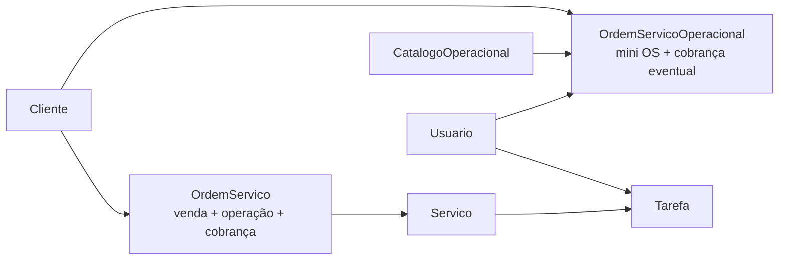

# 01 — Visão geral

## Escopo e arquitetura observada

Backend monolítico Django 5.2/DRF 3.16, persistido em MySQL, autenticado por JWT, Basic ou sessão. Os apps instalados são `contas`, `clientes`, `catalogo`, `ordens_servico`, `analise` e `auditoria` (`config/settings.py:26-45,80-89,144-166`).

| Domínio | Responsabilidade efetiva | Componentes centrais | Confiança |
|---|---|---|---|
| Identidade | Usuários, papéis e permissões | `Usuario`, `TipoUsuario`, permissões DRF | Confirmado |
| Clientes | Pessoa/empresa atendida e contatos | `Cliente` | Confirmado |
| Catálogo | Tipos de serviço principal e operacional | `Catalogo`, `SubitemCatalogo`, `CatalogoOperacional` | Confirmado |
| Comercial | Venda/contratação e suas condições | campos de `OrdemServico` | Confirmado |
| Operação principal | Decomposição da venda em serviços e tarefas | `OrdemServico`, `Servico`, `Tarefa` | Confirmado |
| Operação paralela | Demanda direta, chamada no código de OS operacional/mini OS | `OrdemServicoOperacional` | Confirmado |
| Financeiro | Liberação e marcação de cobrança | campos das duas classes de OS | Confirmado |
| Auditoria | Snapshots/diferenças de quatro entidades operacionais | `RegistroAuditoria` e signals | Confirmado |
| Análise | KPIs calculados sobre dados transacionais | serviços de `apps/analise` | Confirmado |

## Limites observados

O sistema não possui módulos persistentes separados para proposta, pedido, contrato, parcela, contas a receber, nota fiscal, setor ou equipe. O booleano `contrato` e seus detalhes pertencem à OS; `numero_nf` também é apenas um campo da OS. Isso é ausência comprovada no inventário de modelos, não afirmação sobre processos externos.

Há dois agregados operacionais sem relacionamento entre si:

## Fontes e método

Foram examinados modelos, migrações, serializers, viewsets, permissões, signals, serviços analíticos, testes e documentação existente. Documentos preexistentes foram tratados como contexto, nunca como prova isolada. Não houve conexão com banco nem execução de migrações/testes, pois isso criaria ou modificaria estruturas de dados.

## Terminologia conflitante

`OrdemServicoOperacional` aparece como “OS Operacional”, “mini OS” e `MINI_OS` na auditoria (`apps/auditoria/models.py:5-10`; `apps/auditoria/utils.py:15-20`). “Faturamento” sobrevive em valores históricos de auditoria, enquanto o código atual usa “cobrança” (`apps/auditoria/models.py:18-24`).
