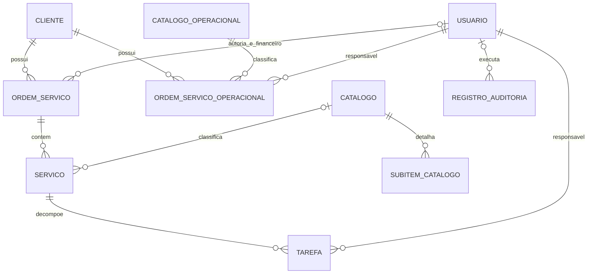

# 03 — Modelo de dados

## Modelo relacional principal

Os nomes de tabela seguem o padrão Django e são confirmados pelas migrações. `id` é `BigAutoField` em todas as entidades.

`RegistroAuditoria` guarda IDs escalares para OS/serviço/tarefa/mini OS; essas ligações não são FKs e por isso não aparecem como relações fortes no diagrama.

## Clientes e identidade

### `Cliente` — `clientes_cliente`

| Campo | Tipo / nulabilidade / padrão | Significado |
|---|---|---|
| `nome` | varchar(100), obrigatório | denominação |
| `tipo_inscricao` | varchar(10), nulo, `cnpj` | CNPJ/CPF/CEI/CNO/CAEPF |
| `numero_inscricao` | varchar(30), nulo | identificador sem unicidade declarada |
| `tipo_cliente` | varchar(10), nulo, `gestao` | gestão/avulso/fornecedor |
| `observacao` | text, nulo | texto livre |
| `nome/setor/email/contato_representante` | strings, nulos | contato |
| `cobranca_revisao_alteracao` | bool, `true` | configuração comercial sem consumo encontrado nas regras atuais |
| `ativo` | bool, `true` | ativação cadastral |
| `data_criacao` | datetime automático | criação |

Não há `UniqueConstraint` para inscrição. Exclusão é protegida se houver qualquer OS/OSO. Evidência: `apps/clientes/models/cliente.py:4-38` e FKs `PROTECT` nos modelos de OS.

### `Usuario` — `contas_usuario`

Extende `AbstractUser`: preserva username, senha, nomes Django, flags, grupos e permissões. Acrescenta `email` único, `nome_completo` obrigatório, `tipo_usuario` (10 papéis; padrão `administrativo`), `ativo=true` e `data_criacao`. Há duas flags de atividade (`is_active` herdada e `ativo` customizada). Evidência: `apps/contas/models/usuarios.py:6-17`, migração `contas/0001_initial.py`.

## Catálogos

| Entidade/tabela | Campos | Restrições e exclusão |
|---|---|---|
| `Catalogo` / `catalogo_catalogo` | `nome varchar(100)`; `descricao text?`; `horas_estimadas decimal(6,2)?`; `complexidade smallint?` (1/2/3) | Sem unicidade. Excluir propaga para serviços por `CASCADE`, apesar de a FK ser opcional. |
| `CatalogoOperacional` / `catalogo_catalogooperacional` | mesmo conjunto, nome varchar(50) | Excluir é bloqueado por OSO (`PROTECT`). |
| `SubitemCatalogo` / `catalogo_subitemcatalogo` | catálogo, nome(150), descrição?, ativo=true, ordem=0, timestamps | `UNIQUE(catalogo,nome)`; `CASCADE` ao excluir catálogo. Nenhuma relação com serviço contratado. |

Evidência: `apps/catalogo/models/*.py`; `apps/catalogo/migrations/0001_initial.py` e `0002_*`.

## Agregado comercial e operacional principal

### `OrdemServico` — `ordens_servico_ordemservico`

| Grupo | Campos |
|---|---|
| Relação | `cliente` FK obrigatória `PROTECT`; autoria/atualização/liberação/cobrança por `Usuario`, todos opcionais e `SET_NULL` |
| Venda | `data_venda date` obrigatória; `valor decimal(10,2)=0`; `forma_pagamento`=boleto; `quantidade_parcelas int?`; `data_acordada_cobranca date?`; contatos de NF como string obrigatória com padrão vazio; `observacao?` |
| Estado | `concluida=false`; `status` aberta/em_andamento/concluida/cancelada, padrão aberta; `prioridade` baixa/média/alta; `prazo?` |
| Contrato | `contrato=false`; objeto, início, fim, nome/e-mail/telefone do gestor opcionais no esquema |
| Cobrança | `cobranca_imediata=false`; `liberada_para_cobranca=false`; data/usuário de liberação opcionais; `cobranca_realizada=false`; `numero_nf int?`; `data_cobranca?`; usuário da cobrança? |
| Rastreio | `criada_em`; `criado_por?`; `data_atualizacao`; `atualizado_por?` |

Não possui constraint de coerência entre flags/datas nem índices de domínio explícitos. Evidência: `apps/ordens_servico/models/ordem_servico.py:28-97`.

### `Servico` — `ordens_servico_servico`

FK obrigatória para OS com `CASCADE`; FK opcional para catálogo com `CASCADE`; descrição obrigatória; status (`aberto`, `em_andamento`, `concluida`, `cancelado`); prioridade; prazo; overrides opcionais de horas/complexidade; datas de início/término/conclusão; finalizador opcional `SET_NULL`; timestamps. Horas e complexidade efetivas usam override local e, na ausência, catálogo (`servico.py:16-69`).

### `Tarefa` — `ordens_servico_tarefa`

FK obrigatória para serviço e responsável, ambas `CASCADE`; descrição opcional; prioridade; prazo; horas opcionais; datas; status (`aberta`, `em_andamento`, `concluida`, `cancelada`); timestamps. Horas efetivas herdam serviço/catálogo quando ausentes (`tarefa.py:15-48`).

## Agregado operacional paralelo

### `OrdemServicoOperacional` — `ordens_servico_ordemservicooperacional`

FKs obrigatórias: cliente `PROTECT`, catálogo operacional `PROTECT`, responsável `CASCADE`. Campos: quantidade positiva=1; descrição?; prioridade; prazo?; override de horas/complexidade?; recebimento/início/término?; status `nao_iniciado|em_andamento|finalizada`; timestamps; `revisao_cliente=false`; `gera_cobranca=false`; data/usuário de liberação?; `cobranca_realizada=false`; `numero_nf varchar(10)?`; usuário da cobrança?. Não possui valor nem data da cobrança (`ordem_servico_operacional.py:15-97`).

## Auditoria

`RegistroAuditoria` — `auditoria_registroauditoria`: entidade, objeto ID/repr, ação, origem, motivo, usuário `SET_NULL`, timestamp, `alteracoes` e `snapshot` JSON, IDs escalares indexados, request ID, IP e user-agent. Índices compostos `(entidade,objeto_id,-criado_em)` e `(acao,-criado_em)`; nenhuma FK para os objetos auditados (`apps/auditoria/models.py:36-73`).

## Cardinalidades e semântica

- Uma OS pode existir sem serviços; nesse caso permanece aberta e não é liberada por conclusão.
- Um serviço pode existir sem tarefas; permanece aberto.
- Uma OS pode envolver vários responsáveis por meio das tarefas, mas não existe setor/equipe persistido.
- A OS operacional tem exatamente um responsável e não pertence a uma OS comercial.
- Campos de status, flags, datas e responsáveis armazenam fatos derivados; não há constraints para impedir combinações incoerentes.
