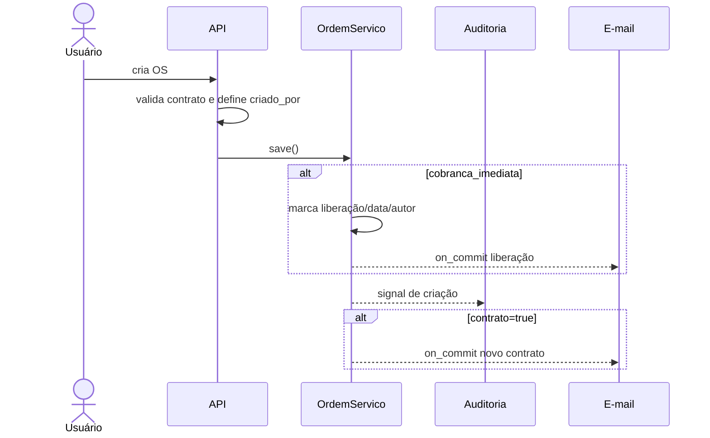
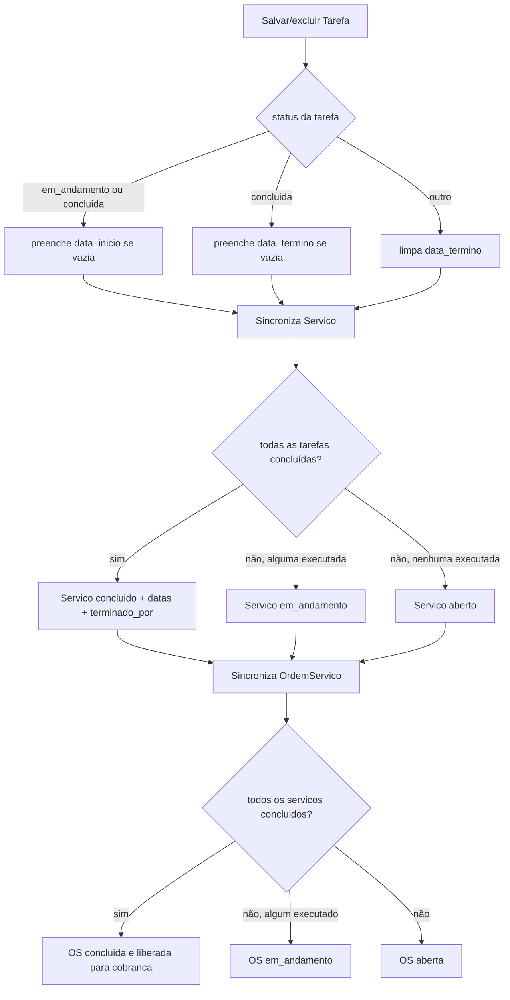

# 04 — Fluxos de dados

## 1. Cadastro de cliente

**Evento:** requisição autenticada ao CRUD. **Efeito:** cria/edita `Cliente`; somente `nome` é inequivocamente obrigatório no modelo. Não há validação de documento, unicidade de inscrição nem auditoria de cliente. Exclusão falha por integridade referencial se houver OS ou OSO (`ClienteViewSet`; FKs `PROTECT`).

## 2. Registro da contratação

**Evento:** criação de `OrdemServico`. **Entidades:** cliente, usuário criador e OS. **Validação:** se `contrato=true`, objeto, início e fim são obrigatórios e fim não pode anteceder início; regra duplicada em modelo e serializer (`ordem_servico.py:98-113`; `ordem_servico_serializer.py:78-102`).

O serializer injeta `criado_por`. O `save()` libera cobrança se imediata e atribui data/autor; o signal agenda e-mail de novo contrato após commit. Ainda não há serviço ou tarefa automaticamente (`ordem_servico_serializer.py:143-147`; `ordem_servico.py:115-126`; `signals.py:14-19`).

## 3. Criação de serviços e tarefas

O serviço é criado explicitamente com FK para a OS, descrição e catálogo opcional. Seu primeiro `save()` executa sincronização: sem tarefas, mantém/força estado aberto e limpa rastreio; em seguida sincroniza a OS (`servico.py:71-164`).

A tarefa é criada explicitamente para um serviço e responsável. O `save()` deriva datas pelo status, persiste, sincroniza o serviço e agenda notificação ao responsável. Reatribuição também notifica; exclusão ressincroniza (`tarefa.py:50-81`; `signals.py:22-36`).

## 4. Execução e propagação de estado

Exceções: serviço `cancelado` não é recalculado, mas conta como “não concluído” para a OS. OS `cancelada` não recalcula seu status/conclusão, embora ainda possa ser liberada se `cobranca_imediata` estiver ativa (`servico.py:82-84`; `ordem_servico.py:139-176`). Tarefa cancelada impede conclusão do serviço.

## 5. Liberação e registro da cobrança da OS

Liberação ocorre uma vez: na criação se imediata, ou ao atingir OS concluída. No segundo caso, data e usuário vêm do último serviço concluído, que por sua vez herda o responsável da última tarefa concluída. A operação usa `QuerySet.update`, com auditoria registrada manualmente, e notifica o financeiro (`ordem_servico.py:157-201`).

O endpoint de cobrança rejeita OS não liberada; se liberada, marca realizada e grava NF, data enviada (ambas opcionais) e usuário. Signal notifica financeiro e comercial (`ordem_servico_viewset.py:122-137`; `signals.py:39-55`). Não há endpoint específico de estorno/cancelamento.

## 6. Fluxo da OS operacional

**Evento:** CRUD direto de `OrdemServicoOperacional`. Cliente, catálogo e responsável são obrigatórios. Status/datas são fornecidos pelo chamador; não há derivação automática de datas.

Em todo `save()`, `gera_cobranca` é sobrescrito por `revisao_cliente`. Se gera cobrança e está finalizada, define liberação/data/responsável se ausentes. Se não gera, limpa data e autor de liberação. O endpoint de cobrança exige ambos `gera_cobranca=true` e data de liberação, depois marca realizada, NF opcional e usuário (`ordem_servico_operacional.py:83-97`; viewset `:135-154`).

## 7. Auditoria e exceções

Signals globais capturam estado anterior e posterior de quatro modelos. Atualizações derivadas via `QuerySet.update` não disparariam signals, por isso chamam `registrar_update_direto` antes da escrita (`apps/auditoria/signals.py:18-65`; `utils.py:112-127`). E-mail falho é registrado em log e não reverte o negócio (`emails.py:44-51`). Validações DRF produzem 400; violações de FK ficam a cargo do ORM/banco.
