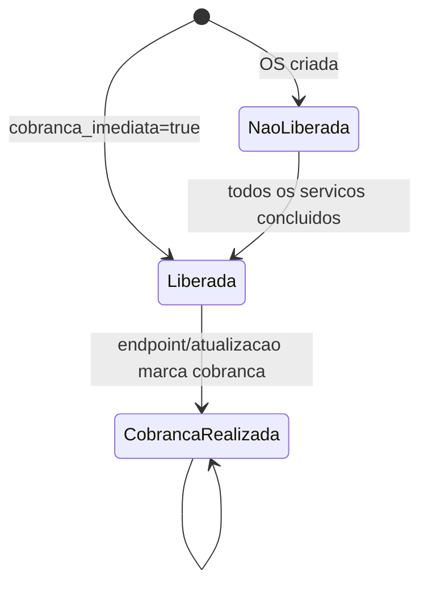

# 06 — Comercial e faturamento

## Representação comercial atual

A entrada de demanda comercial é **`OrdemServico`**. Ela concentra cliente, data da venda, valor total, forma/condição de pagamento, contatos de NF, contrato e estado operacional/financeiro (`apps/ordens_servico/models/ordem_servico.py:28-91`). Não existe proposta ou pedido anterior persistido.

`Cliente` representa empresas e pessoas na mesma tabela, diferenciadas por tipo de inscrição e tipo de cliente. `tipo_cliente=fornecedor` também habita essa entidade. Não há entidade “empresa” separada ou hierarquia matriz/filial.

O catálogo classifica `Servico`, mas os valores não pertencem ao catálogo nem aos itens: há apenas `OrdemServico.valor`, total e mutável. Assim, não é possível reconstruir pelo esquema quanto cada serviço contribuiu para o valor.

## Contratos

Contrato é uma modalidade/flag da OS, não entidade. Objeto e vigência são exigidos quando a flag está ativa; gestor é texto desnormalizado. Não há recorrência, reajuste, anexos, versões ou relação 1:N entre contrato e demandas. A criação dispara e-mail; alterações de campos contratuais recebem categoria de auditoria `contrato`.

## Condições comerciais persistidas

| Informação | Onde | Uso confirmado |
|---|---|---|
| Valor total | `OrdemServico.valor` | e-mails e KPIs financeiros |
| Forma de pagamento | `forma_pagamento` | armazenamento/exibição; sem efeito de fluxo |
| Quantidade de parcelas | `quantidade_parcelas` | armazenamento; sem parcelas geradas |
| Cobrança imediata | `cobranca_imediata` | libera a OS na criação |
| Data acordada | `data_acordada_cobranca` | armazenamento; não condiciona liberação |
| Contato de NF | nome/e-mail na OS | armazenamento; não usado pelo envio de notificação examinado |
| Regra de revisão do cliente | `Cliente.cobranca_revisao_alteracao` | nenhum consumo encontrado |

## Faturamento/cobrança da OS comercial

1. Na criação imediata, o modelo define flag, timestamp e autor (`criado_por`).
2. No fluxo condicionado à execução, toda mudança de tarefa propaga ao serviço e à OS. Todos os serviços precisam estar literalmente `concluida` e deve existir ao menos um.
3. A data de liberação usa o `data_termino`/`data_conclusao` do último serviço; o liberador usa `terminado_por`, derivado da última tarefa concluída.
4. Uma vez liberada, o sincronizador não revoga a liberação se tarefas forem reabertas.
5. Registrar cobrança grava flag, NF inteira opcional, data opcional e usuário. Não cria um registro financeiro separado.

As regras são determinadas por informação comercial persistida (`cobranca_imediata`) e estados operacionais fixos no código (`concluida`). `data_acordada_cobranca`, forma e parcelas não participam.

## Cobrança da OS operacional

A OSO não armazena valor ou data de cobrança. `revisao_cliente` determina `gera_cobranca`; `finalizada` determina liberação. A cobrança registra flag, NF textual e usuário. A configuração homônima do cliente não é consultada, logo toda OSO marcada como revisão gera cobrança, independentemente de `Cliente.cobranca_revisao_alteracao`.

## Permissões e notificações

Os endpoints de registro de cobrança usam apenas `IsAuthenticated`; não há permissão de papel financeiro (`ordem_servico_viewset.py:67-75`; OSO viewset). Usuários financeiros recebem liberação; financeiros e comerciais recebem cobrança realizada (`emails.py:93-136`). O acesso ao painel de valores é mais restrito que a mutação dos dados financeiros.

## Histórico financeiro

A auditoria registra snapshots e diffs, categorizando liberação e cobrança. Não existe ledger, linha de parcela ou histórico financeiro imutável. Como `RegistroAuditoria` usa IDs escalares, o histórico sobrevive à exclusão do objeto, mas perde integridade referencial navegável.

## Lacunas factuais

- Recorrência e parcelamento efetivos: não implementados.
- Cancelamento/estorno de cobrança: nenhum fluxo específico encontrado.
- Emissão/consulta de NF: nenhuma integração encontrada.
- Recebimento, vencimento e inadimplência: não modelados.
- Valor da OSO: não persistido; origem externa não confirmada.
