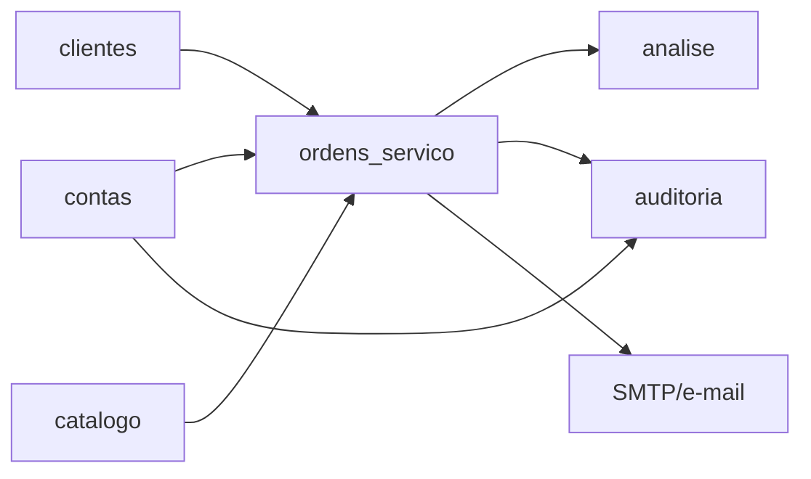

# 08 — Dependências e integrações

## Dependências entre módulos

- `ordens_servico` depende de cliente, usuário e catálogo para suas FKs e permissões.
- `analise` consulta diretamente os modelos transacionais; não há data warehouse ou tabela de agregação.
- `auditoria` importa explicitamente os quatro modelos operacionais e mantém um mapa por nome de classe (`apps/auditoria/signals.py:12-15`; `utils.py:15-20`).
- `contas.permissions.usuario_pode_ver_valores` é compartilhada por análise e templates de e-mail.

## Integrações externas

### E-mail SMTP

Única integração de negócio confirmada. Configuração vem de variáveis `EMAIL_*`; um interruptor global pode desabilitar envio (`config/settings.py:131-142`). O envio é síncrono após commit, sem fila ou retentativa persistente, e captura exceções para não afetar o negócio (`apps/ordens_servico/emails.py:28-52`).

Eventos:

| Evento | Destinatários |
|---|---|
| Nova OS com contrato | todos os usuários com `is_active=true`, `ativo=true` e e-mail; valores variam por papel |
| Tarefa criada/reatribuída | responsável |
| Liberação para cobrança | gestor financeiro e financeiro |
| Cobrança realizada | financeiro e comercial, incluindo gestores |

### Autenticação

JWT com refresh rotativo e blacklist; Basic e sessão também habilitados (`config/settings.py:144-166`). Redefinição de senha envia e-mail, mas não altera entidades de negócio.

## Eventos, sinais e efeitos colaterais

- Signals de ordem de serviço enviam e-mails de contrato/cobrança.
- Signals de tarefa detectam troca de responsável e enviam e-mail.
- Signals de auditoria globais observam `pre_save`, `post_save` e `pre_delete` dos quatro modelos.
- `save()` de tarefa chama sincronização de serviço; `save()` de serviço chama sincronização de OS. Essas são operações com múltiplas escritas e auditorias.
- `transaction.on_commit` é usado para e-mail, mas as sincronizações de status não abrem explicitamente uma transação atômica abrangendo toda a cadeia.

## Tarefas agendadas e assíncronas

Não foram encontrados Celery, filas, cron, management commands de rotina ou scheduler. `migrar_dados_legado` é um comando manual de migração de usuários, não tarefa recorrente (`apps/contas/management/commands/migrar_dados_legado.py`).

## Dependências de relatório

KPIs financeiros usam diretamente `OrdemServico.valor` e flags de cobrança; OSO não entra nos totais financeiros por não possuir valor (`apps/analise/services/financeiro.py:7-67`). Métricas de conclusão dependem de datas derivadas e strings de status. Algumas agregações de OSO ocorrem em Python para contornar ausência de tabelas de timezone no MySQL (`ordens_servico_operacionais.py:20-32`).

## Não encontrado

Nenhuma integração com ERP, emissor fiscal, gateway de pagamento, armazenamento de documentos ou serviço externo de SST foi identificada.
